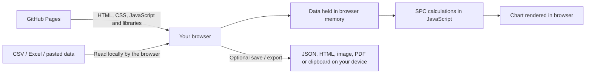

# SimpleSPC — Free browser-based Statistical Process Control tool

SimpleSPC is a free, open-source, browser-based tool for Statistical Process Control (SPC), Pareto analysis, quality improvement and service-performance monitoring.

**Use SimpleSPC:** https://FreeSPC-nhs.github.io/spc-web-tool/

**Source code:** https://github.com/FreeSPC-nhs/spc-web-tool

SimpleSPC was developed independently, particularly to support NHS quality-improvement work, although anyone may use it. It is not a formally supported NHS product or service.

> **Important:** SimpleSPC is intended for anonymous, aggregated or otherwise non-identifiable data. It is not designed for patient-identifiable information or special-category personal data.

## What SimpleSPC does

SimpleSPC lets you upload CSV or Excel files, enter or edit data directly, and create statistical charts without installing specialist software.

All calculations and data processing take place locally in your web browser.

### Available charts

- **Run chart** — monitors values over time using a median and run-chart rules.
- **XmR chart** — monitors individual measurements using a mean and control limits, with optional moving-range analysis.
- **X̄–S chart** — examines subgroup averages and variation within subgroups.
- **C chart** — monitors event or defect counts when opportunities are reasonably constant.
- **P chart** — monitors proportions, using a numerator and denominator.
- **Laney P′ chart** — adjusts P-chart limits when observed variation differs from standard binomial expectations.
- **U chart** — monitors event rates when the number of opportunities varies.
- **Laney U′ chart** — adjusts U-chart limits when observed variation differs from standard Poisson expectations.
- **T chart** — monitors time between rare events.
- **G chart** — monitors opportunities between rare events.
- **Pareto chart** — compares categories by frequency and shows cumulative percentages to help prioritise investigation.

Pareto charts are not time-ordered SPC charts and do not assess statistical process stability.

### Key features

Depending on the chart type, SimpleSPC provides:

- **Chart selection guidance** and setup instructions for different data types.
- **SPC signal detection** to help distinguish routine variation from evidence of change.
- **Baselines and split periods** with recalculated centre lines and control limits where appropriate.
- **Investigated-point exclusions**, keeping excluded observations visible while excluding them from control-limit estimation.
- **XmR moving-range screening** and explanations of how process variation is estimated.
- **P and U dispersion diagnostics**, which can recommend switching to Laney P′ or U′ charts.
- **Performance targets**, including conditional estimates of future outcomes meeting a target where statistically appropriate.
- **Annotations, centre-line labels and chart formatting**, including options accessed by right-clicking charts.
- **A contextual SPC helper**, providing plain-language explanations of charts, results and statistical concepts.
- **Chart export and copying**, including options for sharing charts and summaries.
- **Editable JSON project saves**, allowing charts and settings to be reopened later.
- **Portable offline HTML files**, containing the application, chart data and settings in a self-contained file that can be reopened and edited without an internet connection.

### Intended use and limitations

SimpleSPC is designed to support quality improvement, operational monitoring, education and understanding of process behaviour.

It is not intended for:

- Clinical diagnosis
- Treatment decisions
- Automated decisions about individuals
- Patient-level risk stratification
- Direct-care workflows

Statistical signals and capability estimates require appropriate interpretation. Users remain responsible for organisational decisions, information governance and improvement actions.

---


## Privacy and data handling

### In short

The SPC calculations and processing of the data you load are performed by JavaScript running in your web browser.

SimpleSPC does **not** have an application backend, application database or user-account system. The application does not intentionally send the contents of an uploaded dataset to a SimpleSPC server, analytics service or external AI service.

The JavaScript libraries required by SimpleSPC are stored within the project repository and are served as part of the application rather than being loaded at runtime from third-party content-delivery networks.

There are some important details behind the phrase “processed in your browser”, explained below.

### How browser-only processing works

SimpleSPC is a static web application hosted using GitHub Pages.

When you open the online version, your browser downloads the HTML, CSS, JavaScript and supporting libraries that make up the application from the SimpleSPC GitHub Pages site.

After the application has loaded, data selected through the file picker or entered in the data editor are read and processed by JavaScript in the browser.

A simplified data flow is:



There is no SimpleSPC application server receiving the dataset and no server-side SPC calculation service.

### What happens when I open a CSV or Excel file?

The browser gives the application access to the file that **you explicitly select**.

For Excel workbooks, the application reads the selected file using the browser's `File.arrayBuffer()` API and parses it with the XLSX/SheetJS library in the browser. CSV files are also parsed client-side.

The resulting working data are held in JavaScript memory while you are using the page and are used to calculate and display the SPC chart.

Saved SimpleSPC JSON project files are opened using the browser `FileReader` API and are also processed locally.

### Is my dataset stored by the website?

The application does not intentionally persist the uploaded working dataset to a server, cloud database or application account.

The application uses browser `localStorage` for a small number of interface preferences and flags, such as colour-theme and guidance/settings choices. It does **not** intentionally use `localStorage` to store the uploaded dataset itself.

Working chart data are held in browser memory for the active page/session. Refreshing or resetting the application, closing the page, or replacing the current dataset removes that in-memory working copy from the application.

### What happens when I save my work?

SimpleSPC provides two ways to save an editable chart.

#### JSON project file

**Save chart** creates a `.json` project file containing the underlying chart data and the saved chart settings.

The application creates this file in the browser and downloads it to your device. It is not intentionally uploaded to an application server as part of that process.

A JSON project can later be reopened using **Open saved chart** in SimpleSPC.

#### Portable HTML file

**Save portable chart** creates a self-contained `.html` file containing:

- the SimpleSPC application
- the JavaScript and CSS needed to run it
- the underlying chart data
- the selected chart type and columns
- chart and axis settings
- rules and targets
- baselines
- splits and annotations
- labels and presentation settings

The saved HTML file can be opened directly in a modern web browser without returning to the SimpleSPC website and can be used without an internet connection.

A portable chart remains editable. After opening it, you can change the data or settings and use **Save portable chart** again to create an updated copy.

The browser will normally download a new file rather than automatically overwrite the original.

### Important information about saved files

Both JSON project files and portable HTML files contain the underlying data used to create the chart.

Once downloaded, those files are outside SimpleSPC's control. They should therefore be stored, shared and deleted in accordance with your organisation's normal information-governance, confidentiality and cybersecurity requirements.

The same general principle applies to exported chart images, PDFs, clipboard content, screenshots and presentations: once information has been copied or exported from the application, its subsequent handling is the user's responsibility.

---

## Working offline

SimpleSPC portable HTML files are designed to allow a saved chart to be used without access to the online version of the tool.

A portable HTML file contains the application code, required supporting libraries, project data and chart settings in a single file.

To use one:

1. Create your chart using SimpleSPC.
2. Select **Save portable chart**.
3. Save the resulting `.html` file to an appropriate location.
4. Open the file directly in a modern web browser.
5. Continue editing or analysing the chart as required.
6. Use **Save portable chart** again if you want to create an updated copy.

No software installation or internet connection is required to use the saved portable file.

Because the portable HTML file contains the underlying chart data, it should be handled with the same care as any other locally stored data file.

Browser or organisational security policies may affect some browser features when an HTML file is opened directly from a local drive. Core SPC calculation and chart functionality are designed to operate locally.

---

## Sensitive or identifiable information

SimpleSPC is intended to process data such as:

- anonymous operational data
- aggregated quality or safety measures
- non-identifiable time-series data
- counts
- rates
- percentages
- waiting-time measures
- incident counts
- other operational performance measures

The tool is **not designed for patient-identifiable information (PII) or special-category personal data**.

Browser-local processing reduces the application's exposure to uploaded data, but it does not remove the wider risks of working with sensitive information on a computer. Information could still be exposed through, for example:

- screenshots
- clipboard contents
- saved JSON project files
- portable HTML files
- exported charts or PDFs
- shared presentations
- browser extensions
- an insecure or compromised device
- inappropriate local or shared file storage

Users should apply data minimisation and use anonymised or appropriately aggregated data wherever possible.

Organisations remain responsible for deciding whether SimpleSPC is appropriate for their intended use, complying with their own information-governance and data-protection policies, and completing any local DPIA or governance review that may be required.

The public version does not technically block a user from entering identifiable information, so appropriate use relies on user and organisational governance.

---

## Third-party libraries

The application does not intentionally send uploaded chart data to:

- analytics platforms
- advertising services
- behavioural telemetry services
- external AI/LLM services
- a SimpleSPC backend or database

The SPC Helper uses locally defined responses rather than sending questions or chart data to an external AI service.

### Locally hosted dependencies

SimpleSPC uses a number of open-source JavaScript libraries for functionality such as:

- chart rendering
- chart annotations
- CSV parsing
- Excel import and export
- spreadsheet-style data editing
- PDF and image export

These runtime dependencies are stored within the SimpleSPC repository and are served as part of the application rather than being loaded from third-party CDNs at runtime.

This means that using the normal hosted version requires the browser to retrieve the SimpleSPC application files from GitHub Pages, but the application does not need to contact separate CDN providers to obtain its runtime JavaScript libraries.

Portable HTML files embed the application code and required dependencies directly in the saved file, allowing them to run without retrieving those files from GitHub Pages.

Third-party components remain subject to their own licences.

---

## How to verify the data flow yourself

One reason the project is open source is so that its behaviour can be inspected rather than simply taken on trust.

### Review the source

The main application files are available in this repository, including:

- `index.html` – the page structure and application dependencies
- `spc.js` – file handling, SPC calculations, chart behaviour, save/load and export logic
- `portable.js` – creation and reopening of portable HTML charts
- `spc-helper-library.js` – the locally defined SPC Helper content
- `css/` – styling
- `js/` – supporting application scripts
- `vendor/` – locally stored third-party libraries and supporting files

For example, in the source code you can inspect the functions that:

- read Excel files with `file.arrayBuffer()`
- read saved JSON project files with `FileReader`
- hold working data in the `rawRows` JavaScript variable
- create local downloads with `Blob` and `URL.createObjectURL()`
- collect chart data and settings into saved project objects
- embed application code and project data into portable HTML files
- store limited interface preferences using `localStorage`

### Check network activity in your browser

You can also observe the behaviour yourself using ordinary browser developer tools:

1. Open SimpleSPC.
2. Open your browser's **Developer Tools**.
3. Select the **Network** panel.
4. Allow the page to finish loading.
5. Clear the existing network log.
6. Load a **non-sensitive test file**.
7. Generate or recalculate a chart and try the editing controls.
8. Observe whether those actions create a request that uploads the dataset to an application backend.
9. Save a project or chart and observe that the browser creates a local download.

You will normally see network requests when the online page initially loads because the browser must obtain the application files from GitHub Pages.

Loading data and performing SPC calculations do not intentionally send the selected dataset to a SimpleSPC application backend.

A portable HTML file can also be tested with the computer disconnected from the internet. The file should open and provide its core SPC functionality using the code and data embedded within the file itself.

If the implementation changes in future, the source code remains the definitive way to review what the application is doing.

---

## Technical architecture

The application is deliberately simple:

| Area | Current approach |
|---|---|
| Hosting | GitHub Pages |
| Application type | Static HTML, CSS and JavaScript |
| Application backend/API | None for SPC processing |
| Application database | None |
| Authentication/user accounts | None |
| SPC calculations | JavaScript in the browser |
| CSV/Excel parsing | JavaScript in the browser |
| Chart rendering | JavaScript in the browser |
| Standard project save/load | Local `.json` files selected/downloaded by the user |
| Portable save | Self-contained local `.html` files containing the application, project data and settings |
| Offline use | Supported through saved portable HTML files |
| AI/LLM integration | None |
| Analytics/behavioural telemetry | None intentionally implemented |
| Runtime dependencies | Stored within the repository and served with the application |

This architecture is intended to minimise the amount of operational data exposed beyond the user's browser session.

---

## Running the tool locally

Because SimpleSPC is a static web application, it can also be run from a local web server for development, review or testing.

If you use Git:

```bash
git clone https://github.com/FreeSPC-nhs/spc-web-tool.git
cd spc-web-tool
python -m http.server 8000
```

Then open:

```text
http://localhost:8000
```

Alternatively, you can download the repository files and serve them using another simple local web server.

The runtime JavaScript dependencies required by the application are stored within the repository, so a local copy does not need to retrieve those libraries from public CDNs.

### Using a portable chart instead

If you simply want to continue working with a particular saved chart offline, you do not need to run a local web server.

Use **Save portable chart** in SimpleSPC and then open the downloaded `.html` file directly in your browser.

---

## Intended use, governance and limitations

SimpleSPC provides SPC visualisation and interpretation support. It does not make automated decisions about individuals.

It is not intended to substitute for professional judgement, organisational governance, or a regulated clinical/statistical system where one is required.

The tool is not currently presented as CE- or UKCA-marked medical-device software. Its intended purpose is quality improvement and SPC analysis rather than diagnosis, treatment or individual clinical decision support.

Local organisations should assess suitability for their intended use, including browser/device security, data minimisation, saved-file handling, export handling and any governance requirements that apply locally.

Portable HTML and JSON project files contain the underlying chart data and should be treated as locally stored data files within the user's or organisation's normal governance arrangements.

---

## Open source and licence

SimpleSPC is released under the **MIT License**. See [`LICENSE`](https://github.com/FreeSPC-nhs/spc-web-tool/blob/main/LICENSE).

The intention is to keep the tool genuinely free and reusable. Subject to the MIT licence terms, anyone may:

- use the software
- copy it
- modify it
- create their own version
- redistribute it
- include it in another project
- use it commercially or sell a modified version

You do not need to ask permission to do those things.

The MIT licence requires the copyright and licence notice to be retained in copies or substantial portions of the software. Anyone who receives the MIT-licensed SimpleSPC code continues to receive the permissions granted by that licence; a third party cannot retrospectively withdraw those permissions from copies already released under MIT.

Third-party libraries included in the project may be distributed under their own licences. The MIT licence for SimpleSPC does not replace the licence terms of those third-party components.

The software is provided **“as is”**, without warranty, as set out in the licence.

---

## Development and maintenance

SimpleSPC is independently developed and maintained on a **best-efforts basis**. It is not operated as a formally supported software service.

There is no fixed development roadmap, release schedule, service-level agreement or guarantee of ongoing support.

Updates may be made occasionally where feedback, an identified problem, a compatibility issue or a useful improvement makes an update worthwhile.

The public source code is available so that others can inspect it, learn from it, test it, adapt it or develop their own versions. There is no requirement to wait for the original project to be updated before doing so, provided the licence terms are followed.

---

## Feedback

Feedback and suggestions are welcome, but the repository is **not actively monitored as a support service** and a response or update cannot be guaranteed.

GitHub Issues may be used for feedback if the Issues feature is enabled for the repository, but they should not be treated as a monitored helpdesk or formal support route.

---

## Information-governance summary

The privacy-by-design approach is based on:

- browser-local processing of the working dataset
- no SimpleSPC application backend or server-side dataset processing
- no SimpleSPC application database or user accounts
- runtime libraries stored with and served as part of the application
- no intentional analytics or behavioural telemetry
- no external AI processing
- no routine server-side persistence of uploaded datasets by the application
- user-controlled local saving of JSON and portable HTML project files
- intended use with anonymous, aggregated or otherwise non-identifiable data

The principal residual risk is inappropriate data being entered, displayed, copied, exported, saved or shared by users, together with normal browser/device and local-file security risks, rather than server-side storage by the SimpleSPC application itself.

---

## Licence

MIT License. See [`LICENSE`](https://github.com/FreeSPC-nhs/spc-web-tool/blob/main/LICENSE) for the full text.